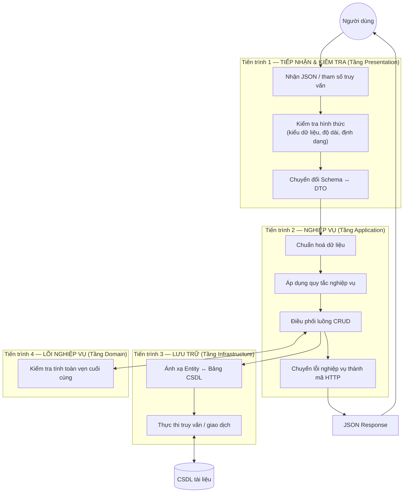
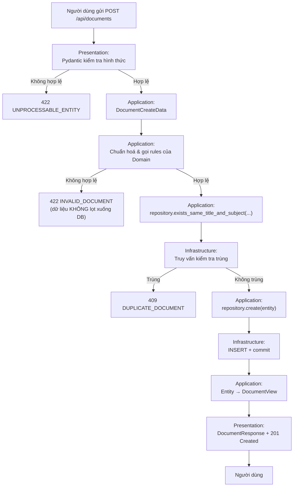
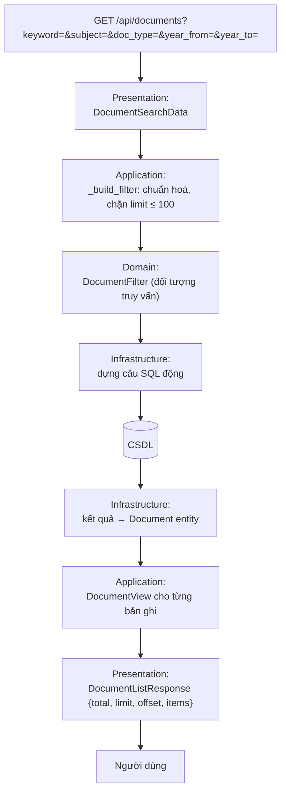

# MỤC 1 — PHÂN TÍCH YÊU CẦU & THIẾT KẾ SƠ ĐỒ LUỒNG DỮ LIỆU

> Tài liệu này trả lời: *ứng dụng phải làm gì* và *dữ liệu chảy qua hệ thống như thế nào*.
> Phần "làm gì" không trộn lẫn với phần "làm bằng cách nào" — sự tách bạch này chính là
> tinh thần của Kiến trúc Cashew.

---

## 1.1. Xác định hệ thống

| Mục | Nội dung |
|-----|----------|
| Tên hệ thống | HỆ THỐNG QUẢN LÝ TÀI LIỆU HỌC TẬP (Document Management System) |
| Mục tiêu | Cho phép sinh viên lưu trữ, tra cứu, cập nhật và xóa tài liệu học tập (bài giảng, bài tập, tài liệu tham khảo, đề thi) một cách nhanh chóng và có trật tự. |
| Người dùng chính | Sinh viên / Giảng viên |
| Hệ thống con | 1 hệ thống con duy nhất: **Tra cứu tài liệu** |

## 1.2. Yêu cầu chức năng (Functional Requirements)

### A. Nhóm "Quản lý tài liệu" (CRUD)

| Mã | Yêu cầu | Mô tả chi tiết | Đầu vào | Đầu ra |
|----|---------|----------------|----------|--------|
| **FR-01** | Thêm tài liệu mới | Người dùng nhập thông tin tài liệu; hệ thống kiểm tra hợp lệ rồi lưu | Tiêu đề, môn học, loại, tác giả, năm, đường dẫn (tuỳ chọn) | Mã tài liệu, thông báo thành công |
| **FR-02** | Xem danh sách tài liệu | Liệt kê toàn bộ tài liệu theo thứ tự năm giảm dần, có phân trang | `limit`, `offset` | Danh sách + tổng số bản ghi |
| **FR-03** | Xem chi tiết tài liệu | Lấy toàn bộ thông tin của một tài liệu theo mã | `id` | Thông tin chi tiết |
| **FR-04** | Cập nhật tài liệu | Sửa một phần hoặc toàn bộ thông tin của tài liệu đã có | `id` + các trường cần sửa | Thông tin sau khi cập nhật |
| **FR-05** | Xóa tài liệu | Xóa vĩnh viễn một tài liệu khỏi hệ thống | `id` | Thông báo thành công |

### B. Nhóm "Tìm kiếm & Lọc"

| Mã | Yêu cầu | Mô tả chi tiết |
|----|---------|----------------|
| **FR-06** | Tìm kiếm theo từ khoá | Tìm trong **tên tài liệu + môn học + tên tác giả**, không phân biệt hoa/thường |
| **FR-07** | Lọc theo môn học | Chỉ hiện tài liệu của một môn cụ thể |
| **FR-08** | Lọc theo loại tài liệu | `bai_giang` / `bai_tap` / `tai_lieu_tham_khao` / `de_thi` |
| **FR-09** | Lọc theo khoảng năm | Lọc tài liệu phát hành trong khoảng `[year_from, year_to]` |
| **FR-10** | Kết hợp nhiều tiêu chí | Các tiêu chí được nối bằng **AND** (thỏa mãn tất cả mới hiện) |
| **FR-11** | Phân trang kết quả | Chặn `limit` tối đa 100 để bảo vệ tài nguyên hệ thống |

### C. Nhóm "Quy tắc nghiệp vụ & xử lý lỗi"

| Mã | Yêu cầu | Quy tắc |
|----|---------|----------|
| **FR-12** | Chống trùng lặp | Không cho tạo/sửa thành tài liệu có **trùng cả tiêu đề và môn học** với tài liệu đang có |
| **FR-13** | Kiểm tra dữ liệu bắt buộc | Tiêu đề, môn học, tác giả không được để trống; năm nằm trong `[1990, 2100]` |
| **FR-14** | Báo lỗi rõ ràng | Mỗi lỗi trả về đúng mã HTTP + mã lỗi nghiệp vụ: 404 / 409 / 422 |

## 1.3. Yêu cầu phi chức năng (Non-functional Requirements)

| Mã | Yêu cầu | Cách đáp ứng trong thiết kế |
|----|---------|----------------------------|
| NFR-01 | **Dễ bảo trì, dễ mở rộng** | Kiến trúc 4 tầng, mỗi tầng một trách nhiệm, ranh giới rõ ràng |
| NFR-02 | **Dễ kiểm thử** | Tầng nghiệp vụ không phụ thuộc database ⇒ test nhanh, không cần hạ tầng |
| NFR-03 | **Linh hoạt hạ tầng** | Đổi SQLite → RAM → PostgreSQL chỉ bằng 1 dòng cấu hình |
| NFR-04 | **Tương thích dữ liệu tiếng Việt** | Chuẩn hoá chuỗi, tìm kiếm không phân biệt hoa/thường cả với dấu thanh |
| NFR-05 | **Tài liệu API tự động** | FastAPI sinh OpenAPI 3.1 tại `/docs` |
| NFR-06 | **An toàn dữ liệu** | Quản lý transaction (commit/rollback) tập trung ở tầng Infrastructure |

## 1.4. Sơ đồ DFD mức 0 (Sơ đồ ngữ cảnh)

```mermaid
flowchart LR
    U["Người dùng<br/>(Sinh viên / Giảng viên)"]
    S[("Hệ thống<br/>Quản lý Tài liệu Học tập")]
    DB[("CSDL<br/>lưu trữ tài liệu")]

    U -->|1. Thông tin tài liệu| S
    U -->|2. Từ khóa / tiêu chí lọc| S
    U -->|3. Mã tài liệu (cần sửa/xóa)| S
    S -->|4. Thông báo kết quả / lỗi| U
    S <-->|5. Đọc / Ghi dữ liệu| DB
```

## 1.5. Sơ đồ DFD mức 1 — Phân rã tiến trình

Sơ đồ này **ánh xạ 1-1 với các tầng kiến trúc**, nhờ đó thấy rõ: DFD mức 1
chính là bản vẽ kiến trúc từ góc nhìn dữ liệu.



## 1.6. Luồng dữ liệu chi tiết cho use-case "THÊM TÀI LIỆU" (DFD mức 2)



## 1.7. Luồng dữ liệu cho use-case "TÌM KIẾM & LỌC"



## 1.8. Bảng trạng thái xử lý một yêu cầu

| Bước | Lớp xử lý | Kiểm tra | Nếu thất bại → HTTP |
|------|-----------|----------|---------------------|
| 1 | Presentation | JSON đúng kiểu, đúng độ dài | `422` |
| 2 | Application | Quy tắc nghiệp vụ (trim, năm, URL) | `422 INVALID_DOCUMENT` |
| 3 | Application | Trùng (tiêu đề + môn) | `409 DUPLICATE_DOCUMENT` |
| 4 | Application | Tài liệu tồn tại (khi sửa/xóa/xem) | `404 DOCUMENT_NOT_FOUND` |
| 5 | Infrastructure | Ràng buộc CSDL | `500` (lỗi hệ thống) |

## 1.9. Ma trận truy vết: Yêu cầu → Cài đặt

| Yêu cầu | Endpoint | Hàm nghiệp vụ | Repository | Kiểm thử |
|---------|----------|--------------|------------|----------|
| FR-01 | `POST /api/documents` | `create_document` | `create` | `test_create_document_success` |
| FR-02 | `GET /api/documents` | `search_documents` | `search` + `count` | `test_search_all_returns_everything` |
| FR-03 | `GET /api/documents/{id}` | `get_document` | `get_by_id` | `test_get_document_detail` |
| FR-04 | `PUT /api/documents/{id}` | `update_document` | `get_by_id` + `update` | `test_update_document_partial` |
| FR-05 | `DELETE /api/documents/{id}` | `delete_document` | `delete` | `test_delete_document` |
| FR-06 | `?keyword=` | `search_documents` | `search` (search_text) | `test_search_by_keyword` |
| FR-07 | `?subject=` | `search_documents` | `search` (WHERE subject) | `test_search_by_subject` |
| FR-08 | `?doc_type=` | `search_documents` | `search` (WHERE doc_type) | `test_search_by_document_type` |
| FR-09 | `?year_from=&year_to=` | `search_documents` | `search` (WHERE year) | `test_search_by_year_range` |
| FR-10 | Kết hợp | `search_documents` | nhiều điều kiện AND | `test_search_combined_criteria` |
| FR-11 | `?limit=&offset=` | `search_documents` | `limit/offset` | `test_search_limit_is_capped_at_100` |
| FR-12 | Chống trùng | `_ensure_not_duplicate` | `exists_same_title_and_subject` | `test_create_duplicate_returns_409` |
| FR-13 | Kiểm tra dữ liệu | `domain/rules.py` | — | `test_create_document_rejects_invalid_data` |
| FR-14 | Báo lỗi | `error_handlers.py` | — | `test_get_missing_document_returns_404...` |

> **Không có yêu cầu nào mà không có test đi kèm** — đây là bảo đảm mỗi dòng checklist
> đều có minh chứng chạy được.
