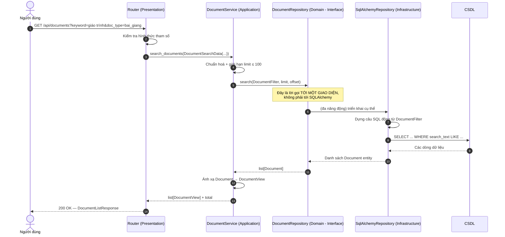
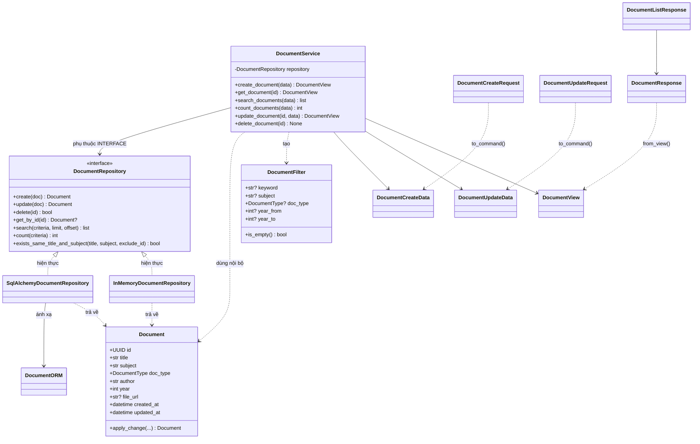

# MỤC 2 — CẤU TRÚC THƯ MỤC & TRÁCH NHIỆM CỦA TỪNG TẦNG

> Kiến trúc Cashew là kiến trúc phân tầng (Layered Architecture) được siết chặt bằng
> **một quy tắc duy nhất: mũi tên phụ thuộc chỉ hướng vào trong.**
> Tài liệu này nói rõ từng thư mục chứa gì, chịu trách nhiệm gì, và **vì sao** phải
> tách như vậy.

---

## 2.1. Sơ đồ kiến trúc tổng quan

```mermaid
flowchart TB
    subgraph OUT["Bên ngoài hệ thống"]
        U["Người dùng / Client HTTP"]
        DB[("CSDL")]
    end

    subgraph PRES["① TẦNG TRÌNH BÀY — Presentation<br/>Biết HTTP. Không biết SQL."]
        R1["documents_router.py<br/>Định nghĩa endpoint (mỏng)"]
        S1["schemas.py<br/>Pydantic Request / Response"]
        D1["dependencies.py<br/>Cấp Service cho từng request"]
        E1["error_handlers.py<br/>Lỗi nghiệp vụ → mã HTTP"]
    end

    subgraph APP["② TẦNG NGHIỆP VỤ — Application<br/>Biết QUY TRÌNH. Không biết lưu trữ."]
        SV["document_service.py<br/>5 use-case CRUD + tìm kiếm"]
        DTO["dto.py<br/>Đối tượng truyền dữ liệu"]
    end

    subgraph DOM["③ TẦNG LÕI — Domain<br/>Biết NGHIỆP VỤ. Không biết công nghệ."]
        EN["entities.py<br/>Document, DocumentType, DocumentFilter"]
        RU["rules.py<br/>Quy tắc bất biến"]
        IF["repository.py<br/>★ INTERFACE (ABC)"]
        EX["exceptions.py<br/>Lỗi nghiệp vụ"]
    end

    subgraph INFRA["④ TẦNG KỸ THUẬT — Infrastructure<br/>Biết CÁCH lưu trữ."]
        OR["orm_models.py<br/>Bảng CSDL"]
        R1B["sql_alchemy_document_repository.py"]
        R2B["in_memory_document_repository.py"]
        DBC["db.py<br/>Engine / Session / Transaction"]
    end

    CR["container.py<br/>★ COMPOSITION ROOT — lắp ráp tất cả"]

    U -->|HTTP| R1
    R1 --> S1
    R1 --> D1
    D1 --> SV
    SV --> DTO
    SV --> IF
    SV <--> RU
    SV --> EX
    R1 -.-> E1
    E1 -->|HTTP status| U

    R1B -.->|hiện thực| IF
    R2B -.->|hiện thực| IF
    R1B --> OR
    R1B --> DBC
    DBC <--> DB

    CR -.->|tiêm (inject)| SV
    CR -.->|tạo| R1B
    CR -.->|tạo| R2B
```

**Đọc sơ đồ:** Mũi tên đặc là dữ liệu đi qua **mỗi request**. Mũi tên đứt là quan hệ
"được tiêm vào" lúc khởi động. Không có mũi tên nào đi **ngược ra ngoài** trở lại tầng
đã gọi nó — đó là toàn bộ ý nghĩa của kiến trúc này.

## 2.2. Cây thư mục chi tiết

```text
TH1/
├── app/
│   ├── __init__.py
│   ├── main.py                        # ① Điểm vào + Application Factory
│   ├── config.py                      # ① Cấu hình từ biến môi trường
│   ├── container.py                   # ①★ Composition Root
│   │
│   ├── domain/                        # ③ TẦNG LÕI
│   │   ├── __init__.py
│   │   ├── entities.py
│   │   ├── rules.py
│   │   ├── repository.py
│   │   └── exceptions.py
│   │
│   ├── application/                   # ② TẦNG NGHIỆP VỤ
│   │   ├── __init__.py
│   │   ├── document_service.py
│   │   └── dto.py
│   │
│   ├── infrastructure/                # ④ TẦNG KỸ THUẬT
│   │   ├── __init__.py
│   │   ├── db.py
│   │   ├── orm_models.py
│   │   ├── sql_alchemy_document_repository.py
│   │   └── in_memory_document_repository.py
│   │
│   └── presentation/                  # ① TẦNG TRÌNH BÀY
│       ├── __init__.py
│       ├── dependencies.py
│       ├── error_handlers.py
│       ├── schemas.py
│       ├── web/
│       │   └── index.html            # Giao diện web (tài nguyên tĩnh)
│       └── api/
│           ├── __init__.py
│           └── documents_router.py
│
├── tests/                             # MỤC 4
├── scripts/seed_data.py
├── docs/
├── requirements.txt
├── requirements-dev.txt
├── pytest.ini
├── .gitignore
└── README.md
```

## 2.3. Trách nhiệm & quy tắc của từng tầng

### ① TẦNG TRÌNH BÀY — `app/presentation/`

| File | Trách nhiệm | **KHÔNG được** làm |
|------|-------------|--------------------|
| `api/documents_router.py` | Khai báo URL, method, tham số; gọi **đúng 1 hàm** của Service | Chứa `if` nghiệp vụ, biết SQL, gọi thẳng Repository |
| `schemas.py` | Định nghĩa hợp đồng JSON, kiểm tra hình thức (độ dài, kiểu) | Chứa logic nghiệp vụ, trả về Domain Entity |
| `dependencies.py` | Cấp `DocumentService` cho từng request (Dependency Injection) | Tự khởi tạo Database bằng `new` |
| `error_handlers.py` | Ánh xạ `DomainError` → mã HTTP (404/409/422) | Chứa quy tắc nghiệp vụ |
| `web/index.html` | **Giao diện web** (HTML/CSS/JS thuần): form thêm/sửa, bảng danh sách, ô tìm kiếm & lọc, nút xoá, phân trang, hiển thị lỗi | Tự kiểm tra nghiệp vụ, truy cập CSDL, nhúng thư viện ngoài |

> **Vì sao tách `schemas.py` riêng?** Vì hợp đồng API với client là tài sản riêng của
> tầng trình bày. Nếu để Entity lọt thẳng ra JSON, mọi lần đổi cấu trúc Entity
> (thêm cột, đổi tên) cũng phá vỡ client. Có Schema, API được phép tiến hoá
> mà không ai bị ảnh hưởng — đây chính là **encapsulation boundary**.
>
> **Giao diện web có làm rò rỉ ranh giới tầng không?** Không. `web/index.html` là
> **tài nguyên tĩnh**: nó chỉ `fetch()` tới các endpoint đã công khai và hiển thị
> kết quả trả về. Không có quy tắc nghiệp vụ nào nằm trong giao diện — nếu có,
> logic sẽ bị lặp ở hai nơi và dễ lệch nhau. Bài kiểm thử
> `test_ui_does_not_duplicate_business_logic` tự động kiểm tra điều này.

### ② TẦNG NGHIỆP VỤ — `app/application/`

| File | Trách nhiệm | **KHÔNG được** làm |
|------|-------------|--------------------|
| `document_service.py` | Chứa toàn bộ quy trình nghiệp vụ: chuẩn hoá, kiểm tra, gọi Repository, quyết định lỗi | Import FastAPI/SQLAlchemy, mở file, ghi log ra console |
| `dto.py` | Định nghĩa dữ liệu vào/ra; chuyển đổi Entity ↔ DTO | Chứa truy vấn, chứa quy tắc kiểm tra dữ liệu |

> **Vì sao không dùng trực tiếp Entity làm dữ liệu vào/ra?**
> Vì Entity là vật thể **sống** (có quy tắc, có hành vi, có thể bị sửa hỏng), còn
> biên ứng dụng cần vật thể **chết** (chỉ mang dữ liệu). Nhờ DTO, tầng Presentation
> **không có cách nào** sửa trực tiếp dữ liệu lõi — đó là bảo đảm tính toàn vẹn
> bằng cấu trúc, không bằng kỷ luật.

### ③ TẦNG LÕI — `app/domain/`

| File | Trách nhiệm | **KHÔNG được** làm |
|------|-------------|--------------------|
| `entities.py` | Định nghĩa `Document`, `DocumentType`, `DocumentFilter` | Kế thừa ORM, dùng `Field` của Pydantic |
| `rules.py` | Quy tắc nghiệp vụ bất biến (một nguồn duy nhất) | Biết HTTP, biết CSDL |
| `repository.py` | **INTERFACE** `DocumentRepository` (ABC) — hợp đồng với tầng dưới | Chứa code SQL, chứa `@abstractmethod` trống rỗng (bắt buộc có nội dung) |
| `exceptions.py` | Lỗi nghiệp vụ (`DocumentNotFoundError`…) | Chứa mã HTTP 404/409 |

> **Vì sao `exceptions.py` không chứa mã HTTP?**
> Vì "tài liệu không tồn tại" là một **sự thật nghiệp vụ**, còn "404" là một **thỏa thuận
> giao thức**. Nếu Domain biết 404, thì khi thay REST bằng gRPC/CLI, cả Domain phải
> viết lại. Giữ ở Domain ⇒ dùng ứng dụng ở đâu, thông điệp lỗi vẫn đúng;
> chỗ ánh xạ sang HTTP nằm ở `error_handlers.py` — **thêm loại lỗi mới chỉ cần thêm
> 1 dòng, không sửa Domain**.

### ④ TẦNG KỸ THUẬT — `app/infrastructure/`

| File | Trách nhiệm |
|------|-------------|
| `db.py` | Engine, Session, transaction (commit/rollback), dispose |
| `orm_models.py` | Định nghĩa bảng `documents` (cấu trúc vật lý) |
| `sql_alchemy_document_repository.py` | Hiện thực interface #1 bằng SQL; dịch Entity ↔ Row |
| `in_memory_document_repository.py` | Hiện thực interface #2 bằng dict trong RAM |

> **Vì sao có `entities.py` (Domain) *và* `orm_models.py` (Infra) cùng mô tả tài liệu?**
> Vì chúng phục vụ mục đích khác nhau:
> `Document` là **khái niệm nghiệp vụ** (bất biến theo thời gian, ai cũng hiểu),
> `DocumentORM` là **hình dạng bảng** (đổi được, tuỳ hệ quản trị).
> Nếu gộp làm một, chạy đổi cấu trúc bảng sẽ kéo theo việc sửa mọi logic nghiệp vụ —
> đúng thứ mà kiến trúc phân tầng sinh ra để tránh.

### ①★ COMPOSITION ROOT — `app/container.py`

| Trách nhiệm |
|-------------|
| Chọn tầng lưu trữ theo cấu hình và **lắp ráp** thành `DocumentService` |
| Là nơi **duy nhất** được phép `new` ra class cụ thể |

> **Vì sao cần "root" riêng?** Nếu Service tự `new` Repository bên trong, ta sẽ mất
> khả năng thay thế khi test. Bằng Constructor Injection + Composition Root, quan hệ
> "ai phụ thuộc ai" **nằm ở đúng một chỗ**, thay vì nằm rải rác trong code. Đây là
> khác biệt giữa một codebase *chạy được* và một codebase *kiểm thử được*.

## 2.4. Bốn luật phụ thuộc (được kiểm tra tự động)

| # | Luật | Kiểm tra bằng |
|---|------|---------------|
| 1 | `domain/` không import FastAPI, Pydantic, SQLAlchemy, sqlite3 | `test_domain_layer_is_technology_agnostic` |
| 2 | `application/` không import framework/hạ tầng, không import `infrastructure`/`presentation` | `test_layer_respects_one_way_dependency_rule[app.application]` |
| 3 | `presentation/` không import SQLAlchemy, sqlite3 | `test_layer_respects_one_way_dependency_rule[app.presentation]` |
| 4 | Chỉ `container.py` + `main.py` được biết cả `application` lẫn `infrastructure` | `test_only_composition_root_wires_the_layers` |

## 2.5. Đối chiếu trước / sau khi áp dụng Cashew

| Khía cạnh | **Trước** — làm theo thói quen | **Sau** — Kiến trúc Cashew |
|-----------|-------------------------------|--------------------------|
| Nơi chứa câu lệnh SQL | Nằm rải trong hàm xử lý nghiệp vụ | Chỉ trong `infrastructure/` |
| Controller | Dày, chứa cả `if` kiểm tra dữ liệu | Mỏng, chỉ 3 việc: nhận → đổi DTO → gọi Service |
| Khi đổi SQLite → PostgreSQL | Sửa hàng loạt file | Sửa 1 dòng cấu hình (`DATABASE_URL`) |
| Unit test tầng nghiệp vụ | Phải dựng database thật | Chạy trong mili giây, không cần DB |
| Thêm loại tài liệu mới (vd: `slide`) | Thêm `if` ở nhiều nơi | Sửa 1 enum + 1 dòng dữ liệu |
| Lỗi nghiệp vụ | Trả 500 chung chung | Ánh xạ chuẩn 404/409/422 có mã lỗi |
| Thêm kiểu lưu trữ (Redis, API ngoài) | — | Thêm 1 file trong `infrastructure/`, không sửa dòng nào khác |
| Vi phạm kiến trúc | Bị phát hiện khi đã hỏng | Bị `pytest` báo đỏ ngay lập tức |

## 2.6. Sơ đồ tuần tự xử lý "Tìm kiếm tài liệu"



> **Điểm cần nhấn:** từ dòng 5 xuống dòng 11, tầng Application **không hề biết** mình
> đang nói chuyện với SQLAlchemy. Chỉ khi hiện thực cụ thể được nối vào thì lệnh SQL mới
> tồn tại. Nếu thay bằng Redis, biểu đồ này **không đổi một dòng nào** — chỉ khối
> "Infrastructure" được thay bằng khối khác.

## 2.7. Sơ đồ lớp quan trọng nhất



## 2.8. Vì sao `DocumentFilter` lại là một class riêng?

Thay vì truyền 5 tham số rời rạc `search(keyword, subject, type, y1, y2, limit, offset)`,
ta gom chúng thành **Query Object** `DocumentFilter`.

- Interface `DocumentRepository` chỉ cần **một** phương thức `search(criteria, …)`.
- Khi cần thêm tiêu chí "lọc theo giảng viên", ta thêm 1 trường vào `DocumentFilter`
  ⇒ **tuân thủ nguyên tắc Open/Closed (mở để mở rộng, đóng để sửa đổi)**.
- Cả hai tầng lưu trữ đều hiểu `DocumentFilter` theo cách **hoàn toàn khác nhau**
  (so khớp chuỗi trong RAM vs. câu `WHERE` trong SQL) mà vẫn phục vụ cùng một yêu cầu.
