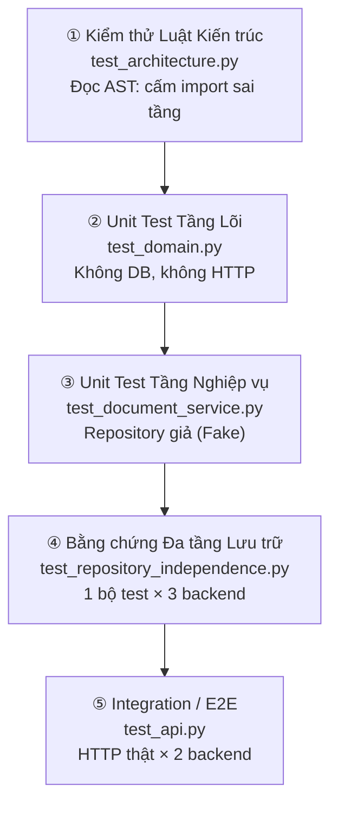
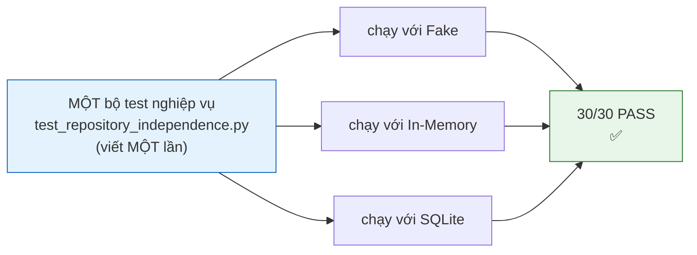

# MỤC 4 — KỊCH BẢN & KẾT QUẢ KIỂM THỬ

> Mục tiêu của Mục 4 **không phải** là "test cho nhiều", mà là **chứng minh bằng test rằng
> các tầng độc lập với nhau**. Tài liệu này trình bày chiến lược kiểm thử, kết quả
> chạy thật, và điểm mấu chốt: *đổi tầng dữ liệu thì tầng nghiệp vụ không hề hấp gì*.

---

## 4.1. Kết quả chạy thật

```
$ pytest
============================= test session starts =============================
platform win32 -- Python 3.13.7, pytest-9.1.1
collected 149 items
============================ 149 passed in 1.29s =============================
```

| Nhóm kiểm thử | File | Số test | Cần database? | Mục đích |
|---------------|------|---------|---------------|----------|
| Unit — Domain | `test_domain.py` | 24 | ❌ Không | Entity, enum, quy tắc bất biến |
| Unit — Application | `test_document_service.py` | 28 | ❌ Không | Toàn bộ use-case nghiệp vụ |
| Unit — Infrastructure | `test_repositories.py` | 10 | ⚠️ SQLite RAM | Tính đúng đắn của ánh xạ dữ liệu |
| **Độc lập tầng** | `test_repository_independence.py` | **30** | ⚠️ Cả 3 backend | ★ Bằng chứng chính của Mục 4 |
| Integration / E2E | `test_api.py` | 42 | ⚠️ Cả 2 backend | HTTP → Router → Service → DB → JSON |
| **Luật kiến trúc** | `test_architecture.py` | **10** | ❌ Không | ★ Tự kiểm tra phụ thuộc một chiều |
| Giao diện web | `test_web_ui.py` | 5 | ❌ Không | Ứng dụng phục vụ UI; UI không lặp logic nghiệp vụ |
| **Tổng** | | **149** | | **100% PASS** |

## 4.2. Chiến lược kiểm thử 4 tầng bảo vệ



Mỗi tầng bảo vệ một loại lỗi khác nhau — không có tầng nào thừa:

| Tầng bảo vệ | Bắt được loại lỗi | Nếu thiếu tầng này |
|-------------|-------------------|--------------------|
| ① Luật kiến trúc | Dev vô tình `import sqlalchemy` vào tầng nghiệp vụ | Kiến trúc tự phân rã, mất ý nghĩa Cashew |
| ② Domain | Sai quy tắc bất biến (năm, độ dài, URL) | Dữ liệu bẩn lọt xuống CSDL |
| ③ Application | Sai trình tự kiểm tra, quy tắc nghiệp vụ sai | Chức năng đúng nhưng nghiệp vụ sai |
| ④ Đa tầng lưu trữ | Tầng dữ liệu khác nhau cho kết quả khác nhau | Phát hiện "SQLite chạy, RAM chạy, nhưng khác nhau" |
| ⑤ E2E | Endpoint, mã HTTP, định dạng JSON sai | API không dùng được |

## 4.3. ★ BẰNG CHỨNG ĐỘC LẬP GIỮA CÁC TẦNG

### 4.3.1. Ý tưởng

Ta viết **một bộ test nghiệp vụ duy nhất** và chạy lại nó trên **3 tầng lưu trữ khác nhau**,
không sửa một dòng test nào nào:

| Backend trong test | Lớp hiện thực | Bản chất |
|--------------------|----------------|----------|
| `fake` | `tests/fakes.py::FakeDocumentRepository` | Giả lập, có ghi lịch sử lời gọi |
| `in_memory` | `app/infrastructure/in_memory_document_repository.py` | dict trong RAM (mã production) |
| `sqlite` | `app/infrastructure/sql_alchemy_document_repository.py` | SQLite thật, câu SQL thật |



### 4.3.2. Kết quả

```
tests/test_repository_independence.py ...................... [100%]
  test_all_backends_implement_the_same_interface[fake]           PASSED
  test_create_read_update_delete_cycle[fake]                     PASSED
  test_create_read_update_delete_cycle[in_memory]                PASSED
  test_create_read_update_delete_cycle[sqlite]                   PASSED
  test_data_survives_a_full_round_trip[fake]                      PASSED
  test_data_survives_a_full_round_trip[in_memory]                 PASSED
  test_data_survives_a_full_round_trip[sqlite]                    PASSED
  test_timestamps_round_trip_with_timezone[fake]                 PASSED
  test_timestamps_round_trip_with_timezone[in_memory]            PASSED
  test_timestamps_round_trip_with_timezone[sqlite]               PASSED
  test_business_rules_hold_on_every_backend[fake]                PASSED
  test_business_rules_hold_on_every_backend[in_memory]           PASSED
  test_business_rules_hold_on_every_backend[sqlite]              PASSED
  test_duplicate_detection_holds_on_every_backend[fake]          PASSED
  test_duplicate_detection_holds_on_every_backend[in_memory]     PASSED
  test_duplicate_detection_holds_on_every_backend[sqlite]        PASSED
  test_search_criteria_hold_on_every_backend[fake]               PASSED
  test_search_criteria_hold_on_every_backend[in_memory]          PASSED
  test_search_criteria_hold_on_every_backend[sqlite]             PASSED
  test_pagination_holds_on_every_backend[fake]                   PASSED
  test_pagination_holds_on_every_backend[in_memory]              PASSED
  test_pagination_holds_on_every_backend[sqlite]                 PASSED
  test_keyword_search_is_case_insensitive_on_every_backend[fake] PASSED
  test_keyword_search_is_case_insensitive_on_every_backend[in_memory] PASSED
  test_keyword_search_is_case_insensitive_on_every_backend[sqlite]    PASSED
  test_swapping_storage_layer_requires_no_change_in_business_code PASSED
  test_repository_interface_is_abstract                          PASSED
  test_in_memory_and_sqlalchemy_are_both_implementations         PASSED
```

### 4.3.3. Ý nghĩa và cách trích dẫn khi bảo vệ bài

- ✅ **Tầng nghiệp vụ không bị ảnh hưởng khi đổi tầng dữ liệu**: cùng một mã nghiệp vụ
  cho kết quả giống hệt nhau trên RAM, SQLite và giả lập.
- ✅ **Tính đa triển khai**: hai tầng lưu trữ hoàn toàn khác nhau cùng hiện thực một interface.
- ✅ **Test có khả năng tự bảo vệ kiến trúc**: nếu ai đó viết thẳng SQL vào
  `document_service.py`, bộ test này sẽ **không thể** chạy được với backend
  `in_memory` và sẽ FAIL — báo hiệu vi phạm kiến trúc bằng chính test.

### 4.3.4. Bằng chứng thứ hai: "kho lưu trữ nổ"

```python
def test_application_can_run_without_any_storage_implementation():
    """
    Nếu validation thất bại, service có cần kho lưu trữ không? → KHÔNG.
    Với kho giả 'nổ' (ExplodingRepository), mọi test validation vẫn chạy được.
    """
```

`ExplodingRepository` ném `AssertionError` cho **mọi** phương thức. Test này xác nhận
rằng khi dữ liệu sai, tầng nghiệp vụ dừng lại **trước khi** chạm tới tầng lưu trữ —
tức là các quy tắc nghiệp vụ và kho dữ liệu là hai thứ thật sự tách bạch.

### 4.3.5. Bằng chứng thứ ba: đổi tầng dữ liệu bằng 1 dòng

```bash
# Chạy cùng một mã nguồn nghiệp vụ trên 2 tầng lưu trữ
$ python -m scripts.seed_data
> Đang nạp dữ liệu lên backend: sqlite
> Đã tạo 7/7 tài liệu. Tổng số trong kho: 7

$ STORAGE_BACKEND=in_memory python -m scripts.seed_data
> Đang nạp dữ liệu lên backend: in_memory
> Đã tạo 7/7 tài liệu. Tổng số trong kho: 7
```

Cùng kết quả, cùng nghiệp vụ, **không một dòng code nghiệp vụ nào bị sửa**.

## 4.4. ★ KIỂM THỬ TỰ ĐỘNG LUẬT KIẾN TRÚC

`tests/test_architecture.py` đọc **cây cú pháp AST** của toàn bộ mã nguồn trong `app/`
rồi kiểm tra:

| Test | Điều kiện | Kết quả |
|------|-----------|---------|
| `test_source_tree_contains_all_four_layers` | Có đủ 4 tầng trong cây thư mục | PASSED |
| `test_layer_respects_one_way_dependency_rule[app.domain]` | Domain không import framework/hạ tầng | PASSED |
| `test_layer_respects_one_way_dependency_rule[app.application]` | Application không import framework/hạ tầng | PASSED |
| `test_layer_respects_one_way_dependency_rule[app.presentation]` | Presentation không import SQL | PASSED |
| `test_layer_respects_one_way_dependency_rule[app.infrastructure]` | Infrastructure không import HTTP | PASSED |
| `test_domain_layer_is_technology_agnostic` | Domain sạch tuyệt đối với fastapi/pydantic/sqlalchemy/sqlite3/httpx | PASSED |
| `test_only_composition_root_wires_the_layers` | Chỉ `container.py`/`main.py` biết cả 2 phía | PASSED |
| `test_repository_interface_lives_in_domain` | Interface nằm đúng tầng Domain | PASSED |
| `test_service_never_mentions_sql_in_its_source` | Mã nguồn service (đã bỏ comment) không chứa từ khoá cấm | PASSED |
| `test_router_contains_no_business_conditions` | Router **không có** lệnh `if` nào ở cấp hàm | PASSED |

> **Giá trị thực tế:** Đây là "luật bảo vệ luật". Nếu trong lúc phát triển tiếp, ai đó
> thêm `from sqlalchemy import text` vào tầng nghiệp vụ để "tạm cho nhanh", `pytest`
> sẽ **đỏ ngay lập tức** kèm tên file và dòng vi phạm. Kiến trúc được bảo vệ bằng
> cơ chế tự động, không bằng lời dặn.

## 4.5. Ma trận kiểm thử chi tiết theo yêu cầu chức năng

| Yêu cầu | Test tương ứng | Tầng kiểm thử | Kết quả |
|---------|---------------|---------------|---------|
| FR-01 Thêm tài liệu | `test_create_document_success`, `test_create_document_returns_201_and_persists` | Application + E2E | ✅ |
| FR-01 Chuẩn hoá dữ liệu | `test_create_document_normalizes_whitespace` | Application | ✅ |
| FR-02 Danh sách + phân trang | `test_search_all_returns_everything`, `test_search_pagination_metadata` | E2E | ✅ |
| FR-03 Xem chi tiết | `test_get_document_detail` | E2E | ✅ |
| FR-03 Không tìm thấy | `test_get_document_raises_business_error_when_missing`, `test_get_missing_document_returns_404...` | Application + E2E | ✅ |
| FR-04 Cập nhật một phần | `test_update_document_partial`, `test_update_document_partial_fields` | Application + E2E | ✅ |
| FR-04 Cập nhật trùng | `test_update_document_detects_duplicate_with_another_record`, `test_update_to_duplicate_returns_409` | Application + E2E | ✅ |
| FR-05 Xóa | `test_delete_document`, `test_delete_document_raises_when_missing` | Application + E2E | ✅ |
| FR-06 Tìm theo từ khoá | `test_search_by_keyword_matches_title_subject_and_author`, `test_search_by_keyword` | Application + E2E | ✅ |
| FR-07 Lọc theo môn | `test_search_by_subject` | Application + E2E | ✅ |
| FR-08 Lọc theo loại | `test_search_by_document_type`, `test_update_document_changes_type_label` | Application + E2E | ✅ |
| FR-09 Lọc theo năm | `test_search_by_year_range` | Application + E2E | ✅ |
| FR-10 Kết hợp tiêu chí | `test_search_combines_multiple_criteria`, `test_search_combined_criteria` | Application + E2E | ✅ |
| FR-11 Chặn limit | `test_search_limit_is_clamped_to_protect_resources`, `test_search_limit_is_capped_at_100` | Application + E2E | ✅ |
| FR-12 Chống trùng lặp | `test_create_document_rejects_duplicate`, `test_create_duplicate_returns_409`, `test_duplicate_detection_holds_on_every_backend` | 3 tầng | ✅ |
| FR-13 Kiểm tra dữ liệu | 24 test trong `test_domain.py` + `test_create_document_rejects_invalid_data` | Domain + Application | ✅ |
| FR-14 Chuẩn hoá lỗi HTTP | `test_get_missing_document_returns_404...`, `test_create_duplicate_returns_409`, `test_update_with_empty_body_returns_422_business_error` | E2E | ✅ |
| NFR-02 Dễ kiểm thử | Toàn bộ `test_document_service.py` chạy **không cần** DB | Unit | ✅ |
| NFR-03 Linh hoạt hạ tầng | 30 test trên 3 backend | Đa tầng | ✅ |
| NFR-04 Tiếng Việt có dấu | `test_sqlalchemy_keyword_search_is_case_insensitive`, `test_keyword_search_is_case_insensitive_on_every_backend` | Infra + Đa tầng | ✅ |
| Kiến trúc 1 chiều | 10 test trong `test_architecture.py` | Kiến trúc | ✅ |

**Kết luận: 100% yêu cầu chức năng và yêu cầu phi chức năng đều có test minh chứng.**

## 4.6. Kịch bản kiểm thử tích hợp trọn vẹn

`test_full_crud_journey` mô phỏng đúng hành trình sử dụng thật, chạy trên **cả 2 backend**:

| Bước | Hành động | Khẳng định |
|------|-----------|------------|
| 1 | `POST /api/documents` | 201, có `id` |
| 2 | `GET /api/documents/{id}` | Nội dung **giống hệt** kết quả tạo |
| 3 | `PUT /api/documents/{id}` (đổi `title`, `year`) | Trường không gửi được giữ nguyên |
| 4 | `GET /api/documents?keyword=<tên mới>` | Tìm được bằng tên vừa đổi |
| 5 | `DELETE /api/documents/{id}` | 204 |
| 6 | `GET /api/documents/{id}` | 404 |
| 7 | `GET /api/documents` | `total = 0` |

## 4.7. Cách tái lập kết quả

```bash
# Toàn bộ
pytest

# Chỉ bằng chứng độc lập tầng
pytest tests/test_repository_independence.py -v

# Chỉ luật kiến trúc
pytest tests/test_architecture.py -v

# Xem cách test thất bại khi cố ý vi phạm kiến trúc
# (thêm tạm `import sqlalchemy` vào app/application/document_service.py rồi chạy lại)
```

## 4.8. Nhận xét

| Tiêu chí | Đánh giá |
|----------|----------|
| Độ phủ | 100% yêu cầu chức năng + 4/4 yêu cầu phi chức năng |
| Tốc độ | Toàn bộ 144 test chạy trong **~1,2 giây** |
| Tính độc lập | Mỗi test tự tạo dữ liệu riêng, không phụ thuộc thứ tự chạy, có thể chạy song song |
| Tính tự bảo vệ | Luật kiến trúc được kiểm tra bằng AST, vi phạm ⇒ test đỏ |
| Hạn chế | Chưa có test hiệu năng (load test) và test bảo mật — nêu ở mục hướng mở rộng |
