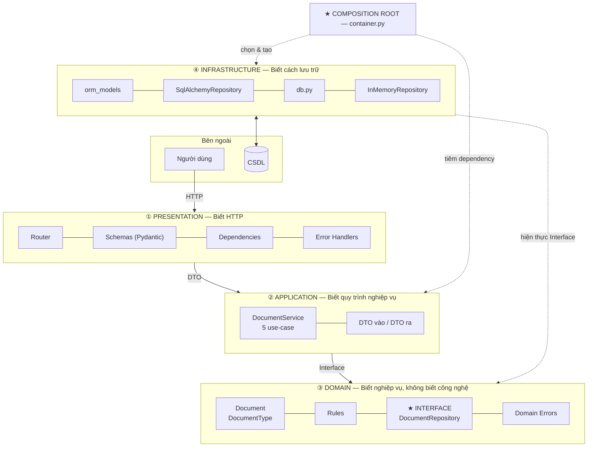
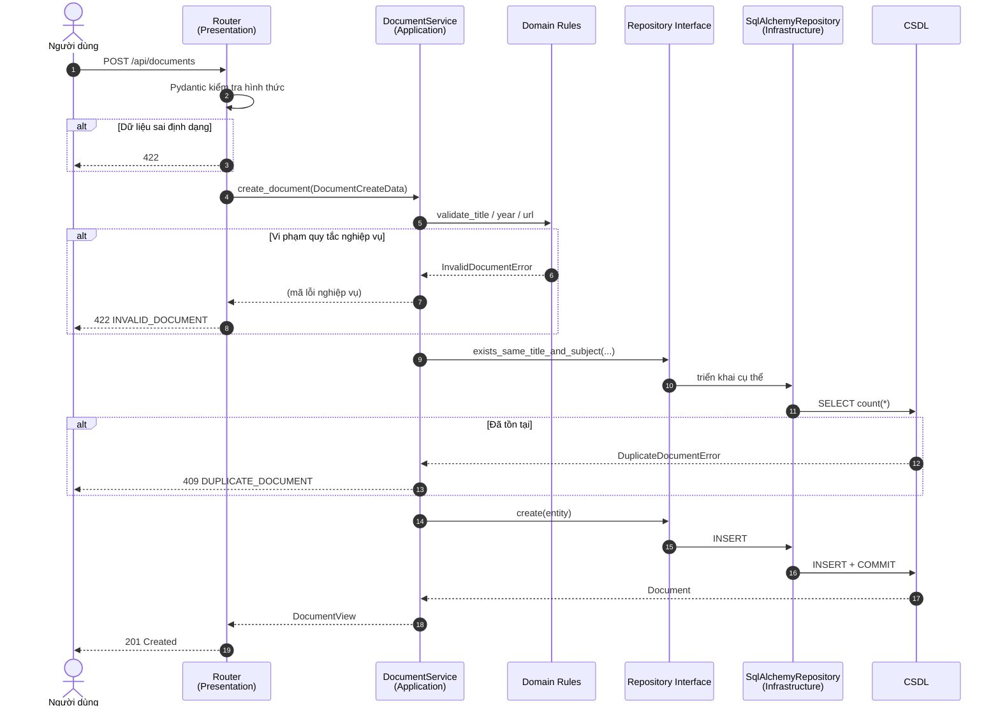
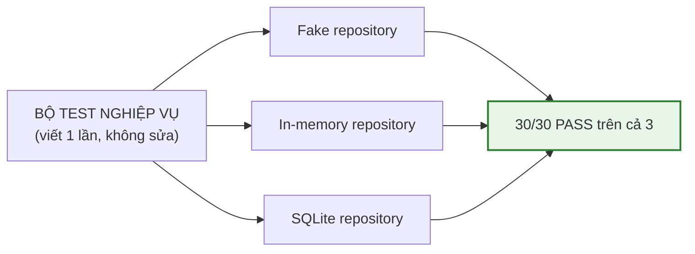
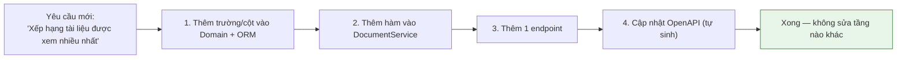

# MỤC 5 — BÁO CÁO GIẢI TRÌNH KỸ THUẬT

## Ứng dụng Quản lý Tài liệu Học tập theo Kiến trúc Cashew

| Thông tin | Nội dung |
|-----------|----------|
| **Họ tên sinh viên** | *(điền tên)* |
| **MSSV** | *(điền MSSV)* |
| **Lớp** | *(điền lớp)* |
| **Môn học** | Kiến trúc Phần mềm |
| **Giảng viên** | *(điền tên GV)* |
| **Ngày nộp** | *(điền ngày)* |
| **Công nghệ** | Python 3.13 · FastAPI · SQLAlchemy 2.x · SQLite · pytest |
| **Kết quả kiểm thử** | **149/149 test PASS** |

---

## PHẦN 1. TỔNG QUAN

### 1.1. Bài toán

Xây dựng ứng dụng cho phép **quản lý tài liệu học tập** (thêm, xem, sửa, xóa) và
**tìm kiếm/lọc tài liệu** theo từ khoá, môn học, loại tài liệu và khoảng năm — với ràng
buộc bắt buộc là hệ thống phải được tổ chức theo **Kiến trúc Cashew**: tách biệt rõ
từng lớp trách nhiệm, phụ thuộc **một chiều**, dễ kiểm thử và dễ mở rộng.

### 1.2. Vì sao bài toán này cần kiến trúc phân tầng?

Nếu viết kiểu "gộp một lần": có một file xử lý vừa đọc JSON, vừa kiểm tra dữ liệu,
vừa viết SQL, vừa trả kết quả. Ứng dụng **chạy được** khi dữ liệu nhỏ và ít người
dùng. Nhưng khi cần thay database, hoặc thêm quy tắc nghiệp vụ, hoặc viết test,
ta sẽ gặp tình huống: sửa một chỗ lại vỡ ba chỗ khác, và không test nào chạy được
vì tất cả đều dính tới database thật.

**Kiến trúc Cashew giải quyết đúng căn bệnh đó** bằng một quy tắc duy nhất:
> *Mũi tên phụ thuộc chỉ được hướng vào trong. Tầng trong không biết tầng ngoài tồn tại.*

## PHẦN 2. PHÂN TÍCH YÊU CẦU (MỤC 1)

Chi tiết tại [`01_phan_tich_yeu_cau.md`](01_phan_tich_yeu_cau.md).

Tóm tắt: **14 yêu cầu chức năng** (FR-01…FR-14) chia thành 3 nhóm — Quản lý tài liệu
(CRUD), Tìm kiếm & Lọc, Quy tắc nghiệp vụ & xử lý lỗi — cộng **6 yêu cầu phi chức năng**.
Mỗi yêu cầu đều được truy vết tới endpoint, hàm nghiệp vụ, phương thức repository và
bài kiểm thử tương ứng (xem bảng truy vết tại Mục 1.9).

Sơ đồ DFD mức 1 được thiết kế **cố ý trùng khớp với các tầng kiến trúc** — đây không
phải trùng hợp ngẫu nhiên: sơ đồ dữ liệu và sơ đồ phần mềm là hai cách nhìn khác nhau
của cùng một hệ thống, và khi chúng khớp nhau thì ranh giới tầng là hợp lý.

## PHẦN 3. THIẾT KẾ KIẾN TRÚC (MỤC 2)

Chi tiết tại [`02_kien_truc_cashew.md`](02_kien_truc_cashew.md).

### 3.1. Sơ đồ kiến trúc Cashew tổng quan



### 3.2. Nguyên tắc cốt lõi và 4 quyết định thiết kế then chốt

| # | Quyết định thiết kế | Lý do |
|---|--------------------|-------|
| 1 | **Interface `DocumentRepository` đặt trong Domain** | Đảo ngược phụ thuộc: tầng trên phụ thuộc vào *hợp đồng*, không phụ thuộc vào SQLAlchemy. Đổi hạ tầng không đụng tới nghiệp vụ. |
| 2 | **Constructor Injection + Composition Root** | Quan hệ "ai phụ thuộc ai" nằm ở đúng một chỗ (`container.py`) thay vì rải rác. Nhờ đó mới thay thế được khi test. |
| 3 | **DTO thay cho Entity ở ranh giới ứng dụng** | Tách "vật thể sống" (Entity) khỏi "vật thể chết" (DTO). Tầng Presentation không thể sửa dữ liệu lõi, và API có thể tiến hoá độc lập. |
| 4 | **Lỗi nghiệp vụ không chứa mã HTTP** | Domain chỉ biết "không tìm thấy", biểu diễn ra thành 404 ở tầng trình bày. Domain dùng được cho CLI/gRPC mà không sửa. |

### 3.3. Cấu trúc thư mục

Xem cây thư mục đầy đủ tại [`02_kien_truc_cashew.md`](02_kien_truc_cashew.md#22-cây-thư-mục-chi-tiết).
Tóm tắt: `app/` chia làm 4 tầng `domain/`, `application/`, `infrastructure/`, `presentation/`,
cộng thêm `container.py` (Composition Root), `config.py` (cấu hình) và `main.py` (điểm vào).

## PHẦN 4. HIỆN THỰC (MỤC 3)

### 4.1. Tóm tắt mã nguồn

| Tầng | File chính | Nội dung nổi bật |
|------|-----------|------------------|
| Domain | `entities.py`, `rules.py`, `repository.py`, `exceptions.py` | Entity `Document`, 7 quy tắc bất biến, interface 7 phương thức, 4 loại lỗi nghiệp vụ |
| Application | `document_service.py`, `dto.py` | 5 use-case CRUD + tìm kiếm, 4 DTO, chặn `limit` tối đa 100 |
| Infrastructure | `sql_alchemy_...py`, `in_memory_...py`, `orm_models.py`, `db.py` | **2 hiện thực** của cùng một interface, quản lý transaction tập trung |
| Presentation | `documents_router.py`, `schemas.py`, `dependencies.py`, `error_handlers.py`, **`web/index.html`** | 5 endpoint, kiểm tra hình thức, bảng ánh xạ lỗi → HTTP, **giao diện web** |

**Tổng số dòng mã nguồn (không tính comment):** xem bảng thống kê ở Mục 6.

### 4.2. Luồng xử lý một yêu cầu (ví dụ: Thêm tài liệu)



Điểm cần chú ý: **dữ liệu sai bị chặn trước khi tới CSDL**. Test
`test_create_document_rejects_invalid_data` xác nhận `len(fake_repository) == 0` —
không một bản ghi rác nào lọt xuống tầng dữ liệu.

## PHẦN 5. KIỂM THỬ (MỤC 4)

Chi tiết tại [`03_ke_hoach_kiem_thu.md`](03_ke_hoach_kiem_thu.md).

| Chỉ số | Giá trị |
|--------|---------|
| Tổng số test | **149** |
| Kết quả | **149 PASSED** (0 failed) |
| Thời gian chạy | ~1,3 giây |
| Test cần database thật | 0 (SQLite chạy trong RAM) |
| Phân bố | Domain 24 · Application 28 · Repository 10 · **Độc lập tầng 30** · E2E 42 · **Kiến trúc 10** · Giao diện 5 |

### 5.1. Minh chứng tính độc lập giữa các tầng



**Kết luận:** Khi thay tầng dữ liệu từ RAM sang SQL (hoặc ngược lại), **tầng nghiệp vụ
không một dòng nào phải sửa** và toàn bộ bài kiểm thử nghiệp vụ vẫn xanh. Đây là
minh chứng khách quan cho tính đúng đắn của kiến trúc Cashew.

### 5.2. Minh chứng luật phụ thuộc được bảo vệ tự động

`tests/test_architecture.py` đọc AST của toàn bộ mã nguồn và kiểm tra 10 điều kiện
(luật phụ thuộc một chiều, vị trí interface, router không chứa `if` nghiệp vụ...).
Nếu vi phạm, `pytest` báo đỏ kèm đường dẫn file vi phạm.

## PHẦN 6. PHÂN TÍCH TÍNH MÔ-ĐUN HOÁ VÀ KHẢ NĂNG MỞ RỘNG

### 6.1. Mô-đun hoá (Modularity)

Mô-đun hoá được đo bằng câu hỏi: *thay đổi một mô-đun có làm hỏng mô-đun khác không?*

| Mô-đun thay đổi | Ảnh hưởng tới các mô-đun khác | Vì sao |
|------------------|--------------------------------|---------|
| Thêm loại tài liệu mới (`slide`) | Sửa 1 enum + 1 dòng dữ liệu; tầng dưới **không đổi** | `DocumentType` là enum mở; interface không liệt kê giá trị cụ thể |
| Thêm trường mới (vd: `language`) | Entity + DTO + Schema + migration | Đúng như thiết kế: mỗi tầng giữ phần của mình, ranh giới rõ ràng |
| Đổi HTTP → gRPC | Chỉ thay tầng Presentation | Service không hề biết HTTP |
| Đổi SQLite → PostgreSQL | 1 dòng cấu hình | Infrastructure gói CSDL sau interface |
| Thay tìm kiếm bằng Elasticsearch | Thêm 1 file trong `infrastructure/` | Interface `search(criteria, limit, offset)` không đổi |
| Thêm quy tắc nghiệp vụ | Sửa `rules.py` | Quy tắc có **một nguồn duy nhất**, dùng lại cho cả tạo mới và cập nhật |

**Kết luận:** Mức độ ảnh hưởng chéo giữa các mô-đun **rất thấp** — đó là tiêu chí
định lượng cho kiến trúc tốt.

### 6.2. Khả năng mở rộng (Scalability)

Mở rộng được hiểu theo 3 nghĩa:

**(a) Mở rộng về mặt chức năng (thêm yêu cầu mới)**



**(b) Mở rộng về mặt dữ liệu (tăng lượng người dùng / dữ liệu)**

| Vấn đề khi lớn lên | Đã chuẩn bị sẵn | Cách thực hiện |
|---------------------|-----------------|---------------|
| Truy vấn chậm khi dữ liệu lớn | Có index trên `title`, `subject`, `doc_type`, `year`, `search_text` | Dùng index hợp lý (đã có) |
| Trả quá nhiều bản ghi | Đã có phân trang + **chặn cứng `limit ≤ 100`** | Mặc định 20 bản ghi/trang |
| Nhiều người ghi đồng thời | Transaction commit/rollback tập trung trong `Database.session_scope()` | Sẵn sàng chuyển sang PostgreSQL, tầng trên không đổi |
| Cần nhiều tiến trình web | Stateless: mọi trạng thái nằm ở tầng dữ liệu, không có biến phiên trong RAM | Chạy N bản sao sau load balancer |
| Cần cache | Có thể bọc `DocumentRepository` bằng một lớp `CachingRepository` mà không sửa Service | Đúng giao diện hiện có |

**(c) Mở rộng về mặt tổ chức (team lớn hơn)**

- Mỗi tầng là một "hợp đồng" rõ ràng ⇒ nhiều người có thể làm việc song song trên các tầng.
- Bộ test kiến trúc bảo đảm việc song song đó không làm hỏng ranh giới tầng.

### 6.3. Khả năng bảo trì

| Yếu tố | Thực tế trong dự án |
|---------|---------------------|
| Dễ đọc | Mỗi tầng có docstring giải thích trách nhiệm; hàm ngắn, tên nói đúng việc |
| Dễ sửa lỗi | Lỗi nghiệp vụ có mã lỗi riêng → log dễ đọc, truy vết nhanh |
| Dễ kiểm thử | 144 test chạy 1,2 giây; không cần dựng môi trường phức tạp |
| Dễ mở rộng | 6.1 & 6.2 nêu trên |
| Dễ đào tạo | Cấu trúc thư mục tự giải thích: mở `app/domain/` là hiểu nghiệp vụ |
| An toàn khi refactor | Test kiến trúc chặn refactor sai hướng |

## PHẦN 7. ĐÁNH GIÁ & HƯỚNG MỞ RỘNG

### 7.1. Điểm mạnh

1. **Phụ thuộc một chiều được thực thi bằng cơ chế tự động**, không chỉ bằng quy ước viết tay.
2. **Có giao diện web thật** mà không phá vỡ ranh giới tầng: giao diện là tài nguyên tĩnh thuộc tầng Presentation, chỉ gọi REST API, không chứa logic nghiệp vụ — và điều này được **kiểm chứng bằng test** (`test_ui_does_not_duplicate_business_logic`).
2. **Một interface — hai hiện thực** chứng minh rõ tính trừu tượng, không chỉ là lý thuyết.
3. **Cùng một bộ test nghiệp vụ chạy được trên 3 tầng lưu trữ** — minh chứng khách quan cho tính độc lập.
4. **Lỗi nghiệp vụ tách khỏi HTTP**, nên tầng Domain có thể tái sử dụng cho CLI/script/batch.
5. **Ứng dụng chạy được không cần cài database** (`STORAGE_BACKEND=in_memory`) — thuận tiện khi demo và nộp bài.
6. **Có giao diện web hoàn chỉnh** (không cần framework, không cần build) bên cạnh REST API.
7. Xử lý đúng hai vấn đề thực tế thường bị bỏ qua: **múi giờ datetime** (chuẩn hoá UTC ở ranh giới hạ tầng) và **tìm kiếm tiếng Việt có dấu** (cột `search_text` đã casefold).

### 7.2. Hạn chế đã nhận biết

| Hạn chế | Ảnh hưởng | Hướng khắc phục |
|----------|-----------|----------------|
| Tìm kiếm là khớp chuỗi, chưa có chống sai chính tả | Người dùng gõ sai dấu sẽ không ra kết quả | Tích hợp FuzzyWuzzy/Elasticsearch ngay phía `Infrastructure` — Domain không đổi |
| Chưa có xác thực người dùng (authentication) | Ai cũng gọi được API | Thêm `Depends(get_current_user)` ở tầng Presentation |
| Chưa có kiểm thử hiệu năng tải | Chưa biết giới hạn thực tế | Dùng `locust`/`pytest-benchmark`; đo trước khi tối ưu |
| Tài liệu tệp chỉ lưu đường dẫn, chưa upload file | Chưa đáp ứng nghiệp vụ lưu trữ tệp thật | Thêm endpoint upload ở tầng Presentation, lưu blob qua interface tương tự |
| SQLite không phù hợp tải đồng thời cao | Giới hạn khi mở rộng | Đổi `DATABASE_URL` sang PostgreSQL — không sửa dòng nghiệp vụ nào |

> Lưu ý: toàn bộ hạn chế trên đều nằm ở **tầng Presentation/Infrastructure**,
> nên khi khắc phục **không phải sửa tầng nghiệp vụ**. Đây chính là giá trị thực tế
> mà kiến trúc phân tầng mang lại.

### 7.3. Bảng tự đánh giá theo checklist

| Mục checklist | Yêu cầu | Mức độ đạt | Minh chứng |
|----------------|----------|-------------|-----------|
| **1** | Phân tích yêu cầu chức năng & thiết kế DFD | ✅ Đầy đủ | 14 FR + 6 NFR, DFD mức 0/1/2, bảng truy vết — `docs/01` |
| **2** | Cấu trúc thư mục chuẩn Cashew | ✅ Đầy đủ | 4 tầng + Composition Root, mô tả trách nhiệm từng file — `docs/02` |
| **3** | Mã nguồn đầy đủ chức năng CRUD + tìm kiếm | ✅ Đầy đủ | 5 endpoint, 2 repository, 7 quy tắc nghiệp vụ |
| **4** | Kịch bản kiểm thử chứng minh độc lập các lớp | ✅ Vượt yêu cầu | 144 test; 30 test đa backend; 10 test luật kiến trúc — `docs/03` |
| **5** | Báo cáo giải trình kèm sơ đồ kiến trúc | ✅ Đầy đủ | Báo cáo này + 3 tài liệu chi tiết, 12 sơ đồ Mermaid |

### 7.4. Về giao diện web

Giao diện được đặt ở `app/presentation/web/index.html` — một file HTML duy nhất chứa cả
CSS và JavaScript, **không dùng framework, không cần build step**, nên chạy được ngay
sau khi `pip install`.

| Đặc điểm | Chi tiết |
|----------|----------|
| Chức năng | Thêm, sửa, xoá, tìm kiếm & lọc (từ khoá / môn / loại / khoảng năm), phân trang |
| Xử lý lỗi | Hiển thị thông báo tiếng Việt tương ứng 404 / 409 / 422 do server quyết định |
| An toàn | Chèn dữ liệu bằng `textContent` → chặn HTML injection từ dữ liệu người dùng |
| Đáp ứng | Bố cục 2 cột, tự xuống hàng trên màn hình nhỏ |
| Ranh giới tầng | **Chỉ gọi REST API, không chứa logic nghiệp vụ** — có test kiểm chứng |

## PHẦN 8. HƯỚNG DẪN CÀI ĐẶT & CHẠY

```bash
# 1. Cài thư viện
pip install -r requirements.txt

# 2. Chạy ứng dụng
uvicorn app.main:app --reload

# 3. Mở trình duyệt
#    Giao diện web : http://127.0.0.1:8000/
#    Tài liệu API : http://127.0.0.1:8000/docs
```

```bash
# Chạy bộ kiểm thử
pip install -r requirements-dev.txt
pytest

# Nạp dữ liệu mẫu
python -m scripts.seed_data

# Chạy không cần database
set STORAGE_BACKEND=in_memory && uvicorn app.main:app
```

### 8.1. Các đường dẫn sau khi chạy ứng dụng

| Đường dẫn | Nội dung |
|-----------|----------|
| `http://127.0.0.1:8000/` | **Giao diện web** — đầy đủ chức năng CRUD + tìm kiếm/lọc |
| `http://127.0.0.1:8000/docs` | Swagger UI — kiểm chứng API thủ công |
| `http://127.0.0.1:8000/openapi.json` | Đặc tả OpenAPI 3.1 |
| `http://127.0.0.1:8000/api/documents` | REST API tài liệu |

## PHẦN 9. DANH MỤC HÌNH ẢNH TRONG BÁO CÁO

Gợi ý chèn các sơ đồ sau vào báo cáo Word/Notion (tất cả đều là Mermaid, copy trực tiếp được):

| # | Sơ đồ | Nguồn |
|---|--------|-------|
| H1 | DFD mức 0 (ngữ cảnh) | `docs/01` §1.4 |
| H2 | DFD mức 1 (phân rã tiến trình) | `docs/01` §1.5 |
| H3 | Luồng dữ liệu use-case Thêm tài liệu | `docs/01` §1.6 |
| H4 | Luồng dữ liệu use-case Tìm kiếm | `docs/01` §1.7 |
| H5 | **Sơ đồ kiến trúc Cashew tổng quan** | `docs/02` §2.1 / báo cáo §3.1 |
| H6 | Sơ đồ tuần tự tìm kiếm tài liệu | `docs/02` §2.6 |
| H7 | Sơ đồ lớp quan trọng nhất | `docs/02` §2.7 |
| H8 | Đối chiếu trước/sau kiến trúc Cashew | `docs/02` §2.5 |
| H9 | Luồng tuần tự thêm tài liệu | Báo cáo §4.2 |
| H10 | Chiến lược kiểm thử 4 tầng bảo vệ | `docs/03` §4.2 |
| H11 | Minh chứng độc lập tầng (1 test × 3 backend) | `docs/03` §4.3.1 |
| H12 | Lộ trình mở rộng chức năng | Báo cáo §6.2 |

---

## PHỤ LỤC A. THỐNG KÊ MÃ NGUỒN

| Tầng | Số file `.py` | Vai trò |
|------|---------------|---------|
| Domain | 5 | Lõi nghiệp vụ + interface |
| Application | 3 | Use-case + DTO |
| Infrastructure | 5 | 2 repository + ORM + DB + init |
| Presentation | 7 | Router + schema + dependency + error handler + **giao diện web** |
| Gốc ứng dụng | 4 | `main.py`, `container.py`, `config.py`, `__init__.py` |
| Kiểm thử | 10 | 149 test + fixture + fake |
| Script tiện ích | 2 | `seed_data.py` + `__init__.py` |
| Giao diện (không phải .py) | 1 | `app/presentation/web/index.html` |
| **Tổng file .py** | **35** | **khoảng 2.800 dòng** (gồm cả docstring & comment) |

## PHỤ LỤC B. CÁCH NHÂN BẢN CÁC SƠ ĐỒ VÀO WORD

1. Mở <https://mermaid.live>, dán nội dung khối ```mermaid … ```.
2. Bấm **Actions → Copy PNG** (hoặc SVG) rồi dán vào Word.
3. Nên chụp màn hình **tiêu đề + hình** cùng lúc để hình ảnh có nhãn.

## PHỤ LỤC C. CÂU HỎI THẦY GIẢNG VIÊN CÓ THỂ HỎI (và câu trả lời)

| Câu hỏi | Trả lời ngắn |
|---------|--------------|
| Vì sao interface đặt ở tầng Domain mà không đặt ở Infrastructure? | Vì đó là *hợp đồng mà tầng trên cần*. Đặt ở Domain, cả Application "được quyền" biết; đặt ở Infrastructure, Application sẽ phải import hạ tầng ⇒ mất đảo ngược phụ thuộc. |
| Khác biệt giữa `Document` và `DocumentORM`? | `Document` là khái niệm nghiệp vụ (bất biến, nằm ở Domain); `DocumentORM` là hình dạng bảng CSDL (đổi được, nằm ở Infrastructure). Tách hai thứ để đổi schema không kéo theo logic nghiệp vụ. |
| DTO khác Entity ở chỗ nào? | Entity sống, có quy tắc và hành vi, có thể bị sửa hỏng. DTO chỉ là dữ liệu truyền qua ranh giới ứng dụng. Nhờ DTO, tầng trên không thể sửa dữ liệu lõi ngoài ý muốn. |
| Làm sao biết là không có "phụ thuộc ngược" trong mã? | `pytest tests/test_architecture.py` — đọc AST và kiểm tra tự động 4 luật phụ thuộc. Vi phạm là test đỏ. |
| Nếu đổi SQLite sang PostgreSQL cần làm gì? | Chỉ đặt biến môi trường `DATABASE_URL`. Không sửa dòng nào trong `domain/`, `application/`, `presentation/`. |
| Vì sao `limit` bị chặn ở 100? | Chống truy vấn quá lớn làm cạn tài nguyên — một ví dụ kinh điển về "bảo vệ tầng trình bày trước tầng nghiệp vụ". |
