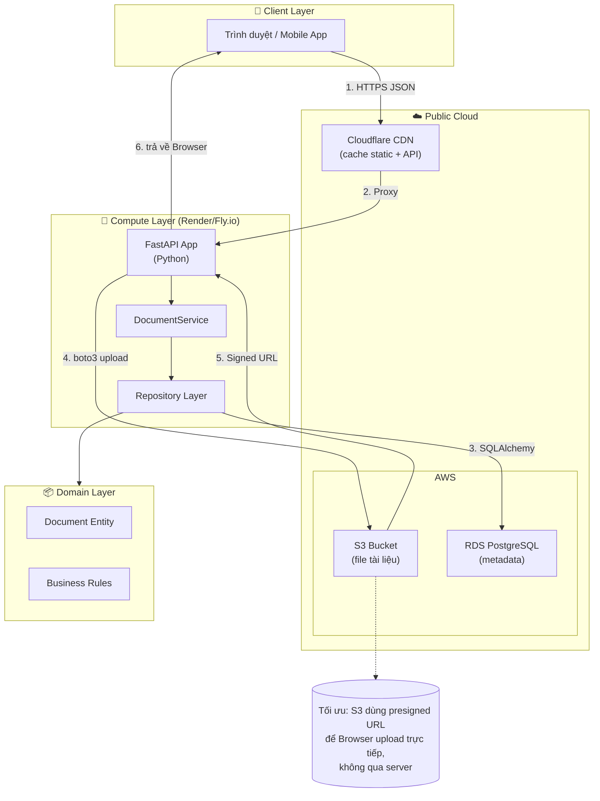

# PHÂN TÍCH TÍCH HỢP CLOUD CHO ỨNG DỤNG QUẢN LÝ TÀI LIỆU

## 1. PHÂN TÍCH CÁC THÀNH PHẦN CỐT LÕI HIỆN TẠI

### 1.1. Frontend (Tầng trình bày)

| Thành phần | Công nghệ | Vai trò |
|------------|-----------|---------|
| Giao diện web | HTML/CSS/JS thuần (1 file) | Form thêm/sửa, bảng danh sách, tìm kiếm, phân trang |
| API Client | `fetch()` trong JS | Gọi REST API |

**Đặc điểm:** Stateless, chạy trên browser, giao tiếp qua HTTP JSON.

### 1.2. Backend (Tầng nghiệp vụ & hạ tầng)

| Thành phần | Công nghệ | Vai trò |
|------------|-----------|---------|
| API Server | FastAPI (Python) | Nhận request, điều phối nghiệp vụ, trả JSON |
| Business Logic | DocumentService | 5 use-case: Create/Read/Update/Delete/Search |
| Repository Layer | SQLAlchemy + In-Memory | Interface `DocumentRepository` - 2 hiện thực |
| ORM | SQLAlchemy 2.x | Ánh xạ Entity ↔ Table |

**Đặc điểm:** Python đơn luồng mặc định, có thể chạy đa luồng qua uvicorn. Không có cơ chế cache.

### 1.3. Database

| Thành phần | Công nghệ | Vai trò |
|------------|-----------|---------|
| Primary DB | SQLite (file) | Lưu trữ metadata tài liệu |
| In-Memory | dict (RAM) | Mode `STORAGE_BACKEND=in_memory` cho test/demo |

**Đặc điểm:** SQLite phù hợp cho dataset nhỏ (<100K records), không hỗ trợ concurrent write tốt.

### 1.4. File Storage (HIỆN TẠI CHƯA CÓ)

| Thành phần | Trạng thái | Ghi chú |
|------------|-----------|---------|
| Lưu file tài liệu | Chỉ lưu URL (`file_url` text field) | Chưa có upload, chưa có cloud storage |

**Hạn chế:** Người dùng phải tự host file ở nơi khác (Google Drive, DropBox...) và paste URL vào form.

---

## 2. CÁC ĐIỂM NGHẼN & HẠN CHẾ TRÊN HẠ TẦNG TRUYỀN THỐNG

| # | Hạn chế | Nguyên nhân | Tác động |
|---|---------|-------------|----------|
| 1 | **SQLite không hỗ trợ concurrent write** | Single-writer, locks entire database on writes | Khi >10 người dùng đồng thời → chậm hoặc lỗi "database is locked" |
| 2 | **Không có cache** | Mỗi request query lại từ đầu | Search/filter chậm với dataset lớn |
| 3 | **File metadata và file thực tách biệt** | Chỉ lưu URL text | Không quản lý lifecycle (xóa file khi xóa metadata), không bảo mật file |
| 4 | **Không có CDN** | Static assets + API cùng server | User ở xa chậm |
| 5 | **Vertical scaling only** | Python GIL + SQLite single-file | Cần thay hạ tầng nếu tăng trưởng |
| 6 | **Không có backup tự động** | SQLite file trên local disk | Rủi ro mất dữ liệu |

---

## 3. LỰA CHỌN MÔ HÌNH CLOUD

### 3.1. Đề xuất: **Public Cloud**

**Lý do phù hợp với dự án sinh viên:**

| Yếu tố | Public Cloud | Private Cloud | Hybrid Cloud |
|--------|--------------|---------------|--------------|
| Chi phí ban đầu | **Thấp** (pay-as-you-go, free tier) | Cao (cần VM, storage) | Trung bình |
| Quản lý | **Nhà cung cấp lo** | Tự quản lý | Tự quản lý phần on-prem |
| Khả năng mở rộng | **Tự động** | Manual | Manual |
| Phù hợp dự án | **Đúng** (quy mô nhỏ, không nhạy cảm) | Sai (không cần) | Thừa |

### 3.2. Dịch vụ cụ thể đề xuất

| Nhu cầu | Dịch vụ | Lý do |
|---------|---------|-------|
| **File Storage** | **AWS S3** (hoặc Azure Blob, Google Cloud Storage) | Standard công nghiệp, pay-per-GB rẻ, tích hợp CDN |
| **Database** | **AWS RDS PostgreSQL** hoặc **Supabase** (PostgreSQL as a Service) | PostgreSQL mạnh hơn SQLite, managed, auto-backup |
| **Compute** | **Render / Railway / Fly.io** (cho Python) | Deploy dễ, free tier đủ demo, auto-scale |
| **CDN** | **Cloudflare** (miễn phí) | Cache static + API |

**Chọn AWS S3 vì:** 
- Tích hợp sẵn với hầu hết framework (boto3)
- Free tier: 5GB, 20,000 GET/month
- SDK đầy đủ, tài liệu phong phú

---

## 4. SƠ ĐỒ KIẾN TRÚC TÍCH HỢP CLOUD



### 4.1. Luồng dữ liệu chi tiết

| Bước | Hành động | Ai thực hiện | Cloud Service |
|------|-----------|--------------|---------------|
| 1 | User upload file qua form | Browser → API | - |
| 2 | API sinh presigned URL | Python (boto3) | AWS S3 |
| 3 | Browser upload trực tiếp lên S3 | Browser → S3 | AWS S3 |
| 4 | S3 trả file key (path) | S3 → API | AWS S3 |
| 5 | API lưu metadata vào PostgreSQL | API → RDS | AWS RDS |
| 6 | Browser request danh sách | Browser → API | Cloudflare CDN → API |
| 7 | API query PostgreSQL + cache | API → RDS | AWS RDS |

---

## 5. ĐÁNH GIÁ TÁC ĐỘNG

### 5.1. Bảo mật

| Khía cạnh | Giải pháp | Mức độ cải thiện |
|-----------|-----------|-----------------|
| **Bảo vệ file** | S3 bucket private, chỉ cấp presigned URL có thời hạn | ⭐⭐⭐⭐⭐ (cao) |
| **Mã hóa** | S3 server-side encryption (AES-256) + HTTPS | ⭐⭐⭐⭐⭐ |
| **Access Control** | IAM roles, bucket policy chặn public access | ⭐⭐⭐⭐ |
| **Database** | RDS encrypted at rest + SSL | ⭐⭐⭐⭐ |
| **API** | Cloudflare WAF chặn DDoS, SQL injection | ⭐⭐⭐⭐ |
| **Vấn đề mới** | Cần quản lý AWS credentials — dùng IAM role, không hardcode | Cần lưu ý |

### 5.2. Chi phí (ước tính tháng đầu)

| Dịch vụ | Free Tier | Phát sinh (ước tính) |
|---------|-----------|----------------------|
| AWS S3 (5GB) | ✅ Miễn phí | $0 nếu <5GB |
| AWS RDS PostgreSQL (db.t3.micro) | ✅ 12 tháng miễn phí | $0 năm đầu |
| Render (Python service) | ✅ Free tier | $0 |
| Cloudflare | ✅ Miễn phí | $0 |
| **Tổng** | | **$0** (năm đầu) |

> **Lưu ý:** Sau free tier, chi phí ~$5-15/tháng nếu mở rộng.

### 5.3. Hiệu suất

| Khía cạnh | Trước | Sau | Cải thiện |
|-----------|-------|-----|-----------|
| **Search/Filter** | Query SQLite trực tiếp | PostgreSQL + INDEX + Cloudflare cache | ⭐⭐⭐⭐ |
| **Upload File** | Không có | Upload trực tiếp S3 (không qua server) | ⭐⭐⭐⭐⭐ |
| **Download** | URL ngoài | Signed URL hoặc CloudFront CDN | ⭐⭐⭐⭐ |
| **Concurrent Users** | ~5-10 người (SQLite) | 100+ (PostgreSQL managed) | ⭐⭐⭐⭐⭐ |
| **Global Latency** | Server ở VN → chậm nếu user nước ngoài | Cloudflare edge + CDN | ⭐⭐⭐⭐ |

---

## 6. KẾT LUẬN & KHUYẾN NGHỊ

### 6.1. Tóm tắt lộ trình nâng cấp

```
Hiện tại                          →  Giai đoạn 1              →  Giai đoạn 2
─────────────────────             ────────────────────────   ────────────────────────
SQLite file                      →  PostgreSQL (RDS)         →  PostgreSQL + Read Replica
Chỉ lưu URL                     →  AWS S3 upload            →  S3 + CloudFront CDN
Không có cache                  →  Cloudflare caching       →  Redis cache (optional)
Manual deploy                   →  Render / Fly.io          →  Kubernetes (nếu cần)
```

### 6.2. Các bước tiếp theo (nếu muốn triển khai)

1. **Giai đoạn 1 (1-2 tuần):** Thay SQLite bằng PostgreSQL (SQLAlchemy hỗ trợ, chỉ cần đổi `DATABASE_URL`).
2. **Giai đoạn 2 (2-3 tuần):** Thêm chức năng upload file qua S3 (dùng `boto3`, tạo presigned URL).
3. **Giai đoạn 3 (1 tuần):** Deploy lên Render/Fly.io, cấu hình Cloudflare.

### 6.3. Điểm cần lưu ý khi trình bày

- **Miễn phí:** Năm đầu có thể chạy hoàn toàn **$0** nhờ free tier AWS + Render.
- **Không phải thay đổi kiến trúc:** Chỉ cần thay `SqlAlchemyRepository` trỏ sang PostgreSQL thay vì SQLite; giao diện và Service **không đổi** — đúng tinh thần Cashew.
- **Phù hợp quy mô:** Với bài toán của sinh viên (vài trăm tài liệu, vài người dùng), Public Cloud là quá mức cần thiết nhưng thể hiện kiến thức cloud computing.

---

## PHỤ LỤC: Mã minh họa tích hợp S3 (thay thế file URL)

```python
# app/infrastructure/s3_storage.py
import boto3
from datetime import timedelta

class S3Storage:
    def __init__(self, bucket: str, region: str = "ap-southeast-1"):
        self._client = boto3.client("s3", region_name=region)
        self._bucket = bucket

    def generate_upload_url(self, key: str, content_type: str, expires: int = 300):
        """Sinh presigned URL để Browser upload trực tiếp lên S3."""
        return self._client.generate_presigned_url(
            "put_object",
            Params={
                "Bucket": self._bucket,
                "Key": key,
                "ContentType": content_type,
            },
            ExpiresIn=expires,
        )

    def generate_download_url(self, key: str, expires: int = 3600):
        """Sinh presigned URL để tải file."""
        return self._client.generate_presigned_url(
            "get_object",
            Params={"Bucket": self._bucket, "Key": key},
            ExpiresIn=expires,
        )
```

Sử dụng trong Service:

```python
s3 = S3Storage("my-document-bucket")
upload_url = s3.generate_upload_url(f"docs/{doc.id}/{filename}", content_type)
# Trả upload_url về frontend → frontend upload trực tiếp lên S3
```

---

> **Tóm tắt cho câu hỏi bảo vệ:** Hệ thống hiện tại có 4 điểm nghẽn (SQLite không concurrent, không cache, file tách biệt, không backup). Giải pháp là **Public Cloud** với **AWS S3** (file) + **RDS PostgreSQL** (database) + **Render** (compute). Chi phí năm đầu **$0** nhờ free tier. Kiến trúc Cashew không thay đổi — chỉ thay đổi tầng Infrastructure.